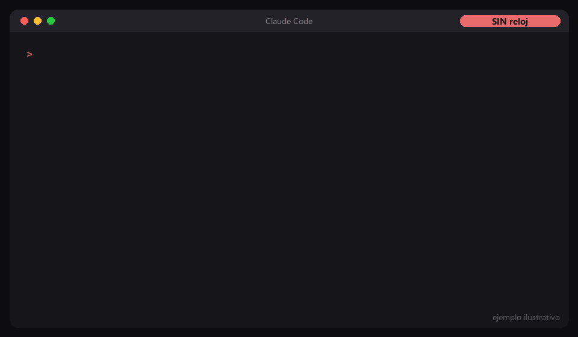

# reloj

[Español](README.md) | **English**

<p align="center">
  
</p>

**Claude Code doesn't know what time it is, doesn't know how much time passed between your messages, and estimates as if it typed the code by hand.** `reloj` ("clock" in Spanish) fixes all three.

```
/plugin marketplace add AldoP4/reloj
/plugin install reloj@reloj
```

No keys, no config. Mac, Linux and Windows.

## What it does

1. **Date and time, always.** Hooks on `SessionStart` and `UserPromptSubmit` give Claude one line: `[reloj] Fri 20 Nov 2026, 15:52 (UTC-06:00) · 3 minutes since your previous message.`
2. **Warns about long gaps.** After 30+ minutes it tells Claude explicitly that what was "today" or "right now" in the conversation no longer is. New sessions also learn when the project was last active.
3. **`/plan-real`: plans with real dates.** It splits work into agent time (minutes), your time (reviews, testing, decisions) and waiting time (approvals, DNS, clients), then gives a date with the weekday, the critical path and what to do in parallel. Optional calibration from `.reloj/estimaciones.jsonl`.
4. **`/reloj`: calendar math.** Days until a date, the date N business days from now, ISO week, end of month/quarter/year.

The skills and messages are in Spanish; Claude answers in your language.

## How it works
A dependency-free Python script reads your system clock. The hooks pass its output to Claude as context (one line per message). To measure gaps it stores only the timestamp of each session's last message in `~/.claude/reloj/estado.json`, pruned after 60 days; never your message text. If anything fails, the hook stays silent and never blocks your session. Set `RELOJ_UTC=-3` (for example) to use another time zone.

**Other [Agent Skills](https://agentskills.io) hosts:** `npx skills add AldoP4/reloj -g` (skills only, no hooks). Requires Python 3.8+.

Made by [Aldo Pazzi](https://github.com/AldoP4) in Puebla, Mexico, with Claude Code. Sibling of [/radar](https://github.com/AldoP4/radar-oportunidades). MIT license.
