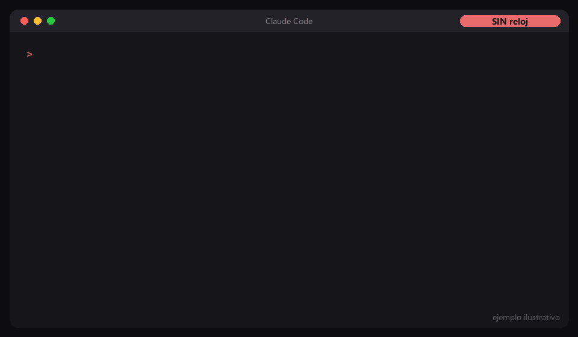

# reloj

**Español** | [English](README.en.md)

<p align="center">
  
</p>

<p align="center">
  <a href="https://github.com/AldoP4/reloj/actions/workflows/validate.yml"></a>
  
  
</p>

**Claude Code no sabe qué hora es, no sabe cuánto tiempo pasó entre tus mensajes y estima como si escribiera el código a mano.** `reloj` arregla las tres cosas.

```
/plugin marketplace add AldoP4/reloj
/plugin install reloj@reloj
```

Sin llaves ni configuración. Funciona en Mac, Linux y Windows.

---

## El problema

1. **No sabe qué día es.** Su "hoy" viene de sus datos de entrenamiento. Por eso habla de "este año" con el año equivocado o da por vigente una fecha que ya pasó.
2. **No sabe cuánto tiempo pasó.** Dejas una conversación el miércoles y vuelves el viernes: para Claude es el mismo momento. Sigue diciendo "ahorita el servidor está corriendo" o "hoy lo despliegas".
3. **Estima en semanas de humano.** Te dice "esto toma 2 o 3 semanas" y luego lo hace en 20 minutos. Y al revés: ignora lo que de verdad tarda, que son tus revisiones y las esperas de otros (aprobaciones, DNS, clientes).

## Qué hace

**1. Le dice la fecha y la hora, siempre.** Un hook le pasa a Claude una línea al empezar cada sesión y con cada mensaje tuyo:

```
[reloj] vie 20 nov 2026, 15:52 (UTC-06:00) · pasaron 3 minutos desde el mensaje anterior.
```

**2. Le avisa cuando pasó mucho tiempo.** Si entre un mensaje y otro pasaron más de 30 minutos, se lo dice en claro:

```
[reloj] vie 20 nov 2026, 09:10 (UTC-06:00) · pasaron 2 días desde el mensaje anterior. Ojo: lo que en esta
conversación era 'hoy', 'ahorita' o 'en un rato' ya no lo es; revisa si algo que dabas por vigente cambió.
```

Al abrir una sesión nueva también le dice cuándo fue la última actividad en ese proyecto.

**3. `/plan-real`: planes con fechas de verdad.** Parte el trabajo en tres tipos y los estima distinto:

| Tipo | Ejemplo | Se mide en |
|---|---|---|
| **Agente** | Escribir la landing, investigar, redactar | Minutos u horas de reloj |
| **Tú** | Revisar, probar en el celular, decidir, pagar | Tus horas disponibles |
| **Espera** | Aprobación de Meta, propagación de DNS, respuesta del cliente | Días corridos o hábiles |

Y te da la fecha con día de la semana, la ruta crítica y lo que puedes hacer en paralelo mientras esperas. Si quieres, guarda cuánto tardó cada tarea de verdad en `.reloj/estimaciones.jsonl` y las siguientes estimaciones se calibran con eso.

**4. `/reloj`: cuentas de calendario.** Cuánto falta para una fecha, qué día cae dentro de N días hábiles, la semana del año, cuánto falta para fin de mes, trimestre o año.

## Cómo funciona

- Un script en Python sin dependencias (`skills/reloj/scripts/reloj.py`) lee el reloj de tu computadora.
- Dos hooks de Claude Code (`SessionStart` y `UserPromptSubmit`) lo corren y le pasan el resultado a Claude como contexto. Es una sola línea por mensaje, así que casi no gasta tokens.
- Para saber cuánto tiempo pasó, guarda la hora del último mensaje de cada sesión en `~/.claude/reloj/estado.json` (o en la carpeta de datos del plugin). Las entradas de más de 60 días se borran solas. No guarda el texto de tus mensajes.
- Si algo falla, el hook no frena tu sesión: simplemente no agrega la línea.

Opcional: si trabajas para alguien en otra zona horaria, define `RELOJ_UTC` (por ejemplo `RELOJ_UTC=-3`).

## Instalación

**Claude Code (recomendado):**
```
/plugin marketplace add AldoP4/reloj
/plugin install reloj@reloj
```
En la app de escritorio también se puede desde **Configuración → Plugins → Agregar**, pegando `AldoP4/reloj`.

**Solo las skills, en otros agentes compatibles con [Agent Skills](https://agentskills.io):**
```
npx skills add AldoP4/reloj -g
```
(Así no se instalan los hooks: tendrás `/reloj` y `/plan-real`, pero no el aviso automático en cada mensaje.)

Requisitos: Python 3.8 o más reciente.

## Límites
- No descuenta feriados: avisa cuando un plazo los cruza.
- La hora es la de tu computadora. Si tu reloj está mal, el reloj también.

## Contribuir
Lo que más ayuda: feriados por país (con fuente oficial), casos donde Claude se confundió con el tiempo aunque tuviera el plugin, y estimaciones reales para calibrar. Corre `python tests/validar_repo.py` antes de un PR.

## Quién lo hizo
[Aldo Pazzi](https://github.com/AldoP4), desde Puebla, México, con Claude Code. Es hermano de [/radar](https://github.com/AldoP4/radar-oportunidades), que encuentra oportunidades de negocio de hoy. En [Nuvver](https://nuvver.org) automatizamos negocios con Claude Code.

Licencia MIT.
